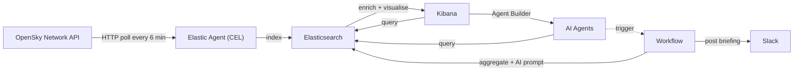
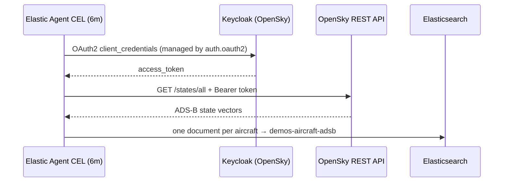

# ADS-B Flight Tracking with the Elastic Stack

Live aircraft position tracking powered by [OpenSky Network](https://opensky-network.org) and the Elastic Stack. A standalone Elastic Agent polls the OpenSky REST API for real-time ADS-B transponder data (Logstash remains available as a fallback), enriches each position with country/region geo-shapes, and indexes everything into an Elasticsearch data stream for visualisation in Kibana.

> **Data source** - All flight data is provided by [The OpenSky Network](https://opensky-network.org), a community-based receiver network that collects air traffic surveillance data and makes it freely available for research and non-commercial purposes. No data is bundled in this repository; it is fetched live from the OpenSky API at runtime.
>
> If you use this project, please review the [OpenSky Network terms of use](https://opensky-network.org/about/terms-of-use).


## Architecture



Each input covers one quadrant of the globe. Splitting the world into four smaller queries is more efficient than a single global request.

| Pipeline  | Coverage                    | Bounding box                |
| --------- | --------------------------- | --------------------------- |
| `adsb-q1` | North-West (Americas/North) | lat 0 to 90, lon -180 to 0  |
| `adsb-q2` | North-East (Europe/Asia)    | lat 0 to 90, lon 0 to 180   |
| `adsb-q3` | South-West (Americas/South) | lat -90 to 0, lon -180 to 0 |
| `adsb-q4` | South-East (Africa/Oceania) | lat -90 to 0, lon 0 to 180  |

The local Agent and Logstash paths write to the `demos-aircraft-adsb` data stream. An ingest pipeline enriches each document with country/region metadata and matching airport coverage zones via geo-shape enrich policies.

### Pipeline Design — Polling with OAuth2

The OpenSky API requires an OAuth2 bearer token (client-credentials grant via Keycloak). The default ingest path is a **standalone Elastic Agent** using the [CEL input](https://www.elastic.co/docs/reference/beats/filebeat/filebeat-input-cel), which has native OAuth2 support and maps each state vector into a document.



1. **`auth.oauth2`** — Agent obtains and refreshes a client-credentials token from the OpenSky Keycloak endpoint. The token never appears in indexed documents.
2. **CEL program** — `GET /states/all` for that quadrant, filters empty/null ICAO24 values, maps the 17-element arrays into named fields, and sets `@timestamp` from `time_position` (falling back to `last_contact`).
3. **Elasticsearch output** — writes to the existing `demos-aircraft-adsb` data stream. The stream's default ingest pipeline still enriches country/region and airport coverage-zone matches.

Four CEL inputs (`adsb-q1`–`adsb-q4`) run in one Agent process, one per bounding box. A failed HTTP call yields an empty event batch for that interval rather than blocking the other quadrants.

**Logstash fallback** — set `INGEST_ENGINE=logstash` in `.env` (or `make up INGEST_ENGINE=logstash`). The Logstash pipelines remain in `logstash/pipeline/` and use the older heartbeat → OAuth2 `http` filter → API `http` filter chain, because Logstash `http_poller` cannot perform an OAuth2 token exchange. Do not run both engines at once against the same cluster; they would double-index.

### Fleet-managed OpenSky integration

The demo can use the **OpenSky Network** Elastic integration instead of its
local collector. The compatibility path targets the integration's
`opensky.state_vector` data stream and preserves the integration's ECS fields
while adding the top-level fields and geo enrichment expected by this demo.

1. Install the OpenSky integration in Fleet, enable **All-aircraft positions**,
   and wait for its first successful poll.
2. Set `INGEST_ENGINE=opensky_integration` in `.env`.
3. Set `OPENSKY_INTEGRATION_DATA_STREAM` to the concrete stream for the policy
   namespace, for example `logs-opensky.state_vector-default`.
4. Run `make setup`. Do not start the local Agent or Logstash collector.

Setup connects `demo-aircraft-adsb.opensky-compat` through the supported
`logs-opensky.state_vector@custom` ingest pipeline and merges the corresponding
field mappings into the data stream's `@custom` component template. The
pipeline copies `host.id`, `host.geo.location`, and
`opensky.state_vector.*` into the demo field contract, applies country and
airport coverage-zone enrichment, and exposes the stream through the read-only
`demos-aircraft-adsb` data-stream alias. New documents are compatible
immediately; documents indexed before compatibility setup retain only the
integration's native field shape.

To return from Fleet mode to local Agent or Logstash ingest, change
`INGEST_ENGINE` and rerun `make setup`; setup removes the compatibility alias
before the local collector writes. Moving an existing local deployment to
Fleet mode requires a clean deployment because setup will not delete or
replace the existing `demos-aircraft-adsb` data stream.

### AI Agent

The setup script deploys three AI agents via the Kibana Agent Builder:

- **Aircraft ADS-B Tracking Specialist** — answers natural-language questions about flight data: locate aircraft by callsign or ICAO24, query positions over geographic regions, analyse altitude and speed patterns, and aggregate flights by country or region. Includes an **aircraft history report** tool that generates comprehensive reports for individual aircraft — flight itinerary with callsigns and airports, airframe details from [adsbdb](https://www.adsbdb.com), live position from [adsb.lol](https://adsb.lol), related Kibana cases, and a link to the Aircraft Detail dashboard. Also includes a **defunct callsign detector** that scans for aircraft using callsign prefixes from known defunct airlines.
- **ADS-B Daily Briefing Analyst** — generates and discusses daily aviation briefings from aggregated ADS-B data.
- **Squawk 7500 Hijack Assessment Analyst** — evaluates squawk 7500 (hijack) signals using flight history, external enrichment, and AI-powered false-positive analysis.

Once deployed, agents are available in Kibana under **AI Agents** (or via the `POST /api/agent_builder/converse` API).

Make sure you have an [LLM configured in Kibana](https://www.elastic.co/docs/explore-analyze/ai-features/llm-guides/llm-connectors), select an agent and throw some natural language querying its way.

### Workflows

The setup script deploys several [Elastic Workflows](https://www.elastic.co/docs/explore-analyze/workflows) on the supported Elastic Stack 9.5 baseline:

**Daily Flight Briefing** — runs automatically at 08:00 Europe/London each day:

1. Aggregates 24 hours of ADS-B data — unique aircraft, busiest airports, top origin countries, regional traffic by UN subregion, activity breakdown, and emergency squawk codes (7500/7600/7700)
2. Invokes the **ADS-B Daily Briefing Analyst** agent to generate a natural-language briefing from the aggregation results
3. Posts the briefing to a Slack channel (if a Slack connector is configured)

**Squawk 7500 Hijack Investigation** — triggered automatically by an ES|QL alert rule when an aircraft transmits squawk code 7500 (hijack). The alert uses per-row grouping so each aircraft gets its own alert and workflow execution. The workflow:

1. Deduplicates against existing open Kibana Cases (one investigation per aircraft)
2. Creates a new case with aircraft details and attaches the triggering alert
3. Enriches with flight history, aircraft registry (adsbdb), live position (adsb.lol), and news articles (GNews)
4. Invokes the **ADS-B Hijack Assessment** agent for AI-powered false-positive analysis
5. Routes based on AI triage assessment — Slack notification for genuine threats, tagging for false positives

**Aircraft History Report** — triggered by the ADS-B tracking agent when a user asks about a specific aircraft's recent movements (e.g. "where has 406bbb been in the last 30 days?"). The workflow gathers flight summary aggregations, position samples, airframe details from adsbdb, live position from adsb.lol, and related Kibana cases. The agent composes the data into a structured markdown report with a link to the Aircraft Detail dashboard.

**Defunct Callsign Detector** — runs daily at 07:30 Europe/London and on-demand via the ADS-B tracking agent. Uses ES|QL LOOKUP JOIN to cross-reference live ADS-B callsign prefixes against a lookup index of 781 known defunct airlines (sourced from Wikipedia). Detects aircraft broadcasting callsign prefixes from airlines that have ceased operations — results are investigative leads for stale transponder configurations, reallocated ICAO designators, or suspicious activity. Also runs inline as part of the Daily Flight Briefing.

Supporting workflows (`squawk-7500-enrich`, `squawk-7500-create-case`, `hijack-cases-summary`, `adsb-aggregate-stats`) are deployed as agent tools. Workflows use source-controlled IDs and the bulk create/overwrite API before alert actions and tools are wired.

> **Version baseline** — Elastic Stack 9.5 is required for the complete setup, including stable workflow IDs, Agent Builder traces, per-agent access control, workflow execution privileges, and GA case analytics indices. Capability probes keep core ingestion and dashboards usable on deployment types that omit ILM, snapshot repositories, Cases, alerting, or Agent Builder.

> **Observability features** — This demo leverages Elastic Observability capabilities including the Observability solution view (Kibana space), Cases (`owner: observability`), and alerting (`consumer: observability`). The full experience requires a deployment that supports these features — see the [deployment comparison table](#getting-started-with-elasticsearch).

**Prerequisites for workflows and agents:**

- **LLM connector** — an AI connector (OpenAI, Gemini, etc.) must be [configured in Kibana](https://www.elastic.co/docs/explore-analyze/ai-features/llm-guides/llm-connectors) as the default AI connector. The workflows and agents use whichever connector is set as the default.
- **Agent Builder** — enable the Agent Builder in Kibana: _Stack Management > AI Settings > Generative AI > Agent Builder_ and toggle it on.
- **Workflows** — enable the Workflows UI in Kibana: _Stack Management > Advanced Settings_ > search for `workflows:ui:enabled` and set it to `true`.
- **Dark mode (optional)** — if preferred, enable dark mode for your space: _Stack Management > Advanced Settings_ > search for `theme:darkMode` and set it to `Enabled`.
- **Slack (optional)** — to receive briefings in Slack, [create a Slack app](https://api.slack.com/messaging/webhooks) with an incoming webhook and add the webhook URL to `.env` as `SLACK_WEBHOOK_URL`. The setup script creates the Kibana connector automatically. Alternatively, configure the connector manually in Kibana under Stack Management > Connectors.
- **Cases (optional)** — the squawk 7500 hijack investigation workflow uses Kibana Cases for full functionality — tracking triage assessments, deduplication, and Slack routing. Cases are available on Cloud Hosted, Observability Serverless, and start-local (see the [deployment comparison table](#getting-started-with-elasticsearch)). Workflows use `owner: observability` for case management. Without Cases (e.g. Elasticsearch Serverless), the workflow and daily briefing still operate but skip case management and investigation-outcomes sections gracefully.
- **GNews (optional)** — the hijack investigation and enrichment workflows correlate squawk 7500 signals with news articles via the [GNews API](https://gnews.io). Add the key to `.env` as `GNEWS_API_KEY`; setup stores it in an encrypted Kibana `.http` connector `secretQueryParams`. The key is never written into deployed workflow URLs. If not set, news requests run without authentication and fail gracefully if the service requires a key.
- **Agent traces** — trace collection is enabled by default in 9.5. Setup installs the managed **[Elastic] Agent Builder Overview** dashboard in the selected space. Demo roles can read `traces-agent_builder.otel-*`.
- **Dashboard as code** — setup deploys the **ADS-B Operations & Cases** dashboard through the GA 9.5 Dashboards API. Inline ES|QL panels show ingest freshness, enrichment failures, emergency squawks, and space-scoped Cases analytics; pinned ES|QL and time-slider controls keep the definition portable. The existing spatial dashboards remain saved objects because the API does not yet support Maps panels.
- **Private hijack agent (optional)** — configure comma-separated Kibana usernames in `HIJACK_AGENT_ALLOWED_USERS`, `HIJACK_AGENT_EDITORS`, and `HIJACK_AGENT_MANAGERS`. Setup grants the corresponding User, Editor, and Manager roles through the 9.5 per-agent access-control API.

## Getting Started with Elasticsearch

You need Elasticsearch and Kibana 9.5 or later. Three deployment options are supported:

| Option                                                                          | Cases | Alert-triggered workflows | Notes                                                                                        |
| ------------------------------------------------------------------------------- | :---: | :-----------------------: | -------------------------------------------------------------------------------------------- |
| **Elastic Cloud Hosted** ([elastic.co/cloud](https://elastic.co/cloud))         |  Yes  |            Yes            | Full-featured managed deployment. Recommended for the full demo experience.                  |
| **Observability Serverless** ([elastic.co/cloud](https://elastic.co/cloud))     |  Yes  |            Yes            | Serverless project with Cases and alerting. Choose this if you want serverless.              |
| **start-local** ([elastic/start-local](https://github.com/elastic/start-local)) |  Yes  |            Yes            | Local Docker deployment. Run `curl -fsSL https://elastic.co/start-local \| sh`.              |
| Elasticsearch Serverless                                                        |  No   |            No             | Core ingestion and dashboards work, but Cases and alert-triggered workflows are unavailable. |

> **Note** — The hijack investigation workflow uses Kibana Cases to record investigation outcomes. On deployments without Cases support the workflow still runs but skips case creation gracefully (`on-failure: continue`). All other features — ingestion, dashboards, AI agents, the daily briefing — work on every deployment type.

`setup.sh` probes deployment capabilities instead of assuming Hosted features:

- Data Stream Lifecycle manages the 730-day retention period on every deployment. The legacy ILM policy is available only as an explicit compatibility target and is not part of the default setup.
- Set `DLM_FROZEN_AFTER` (for example `30d`) to request a 9.5 frozen searchable-snapshot transition. Setup adds it only with an Enterprise/trial licence and an available snapshot repository.
- Agent Builder traces, per-agent access control, alerting, or Cases unavailable: the optional resource is skipped with a warning.
- TSDS remains the common data model. Historical imports are a cluster-wide opt-in (`ENABLE_HISTORICAL_TSDS_IMPORT=true`) and are applied only when the deployment accepts the required cluster settings.

Your Elasticsearch and Kibana endpoint URLs are shown on the deployment overview page (Cloud) or at the end of the install (start-local). You will also need an API key — see below.

## Generate an API Key

Open Kibana, head to **Dev Tools** (_hint_: it's in the bottom left), copy and run the following:

```json
POST /_security/api_key
{
  "name": "adsb-demo",
  "role_descriptors": {
    "adsb_setup": {
      "cluster": [
        "manage",
        "manage_security"
      ],
      "indices": [
        {
          "names": [
            "geo.shapes-world.countries-50m",
            "adsb*",
            "demos-aircraft-adsb*",
            "logs-opensky.state_vector-*"
          ],
          "privileges": ["create_index", "write", "read", "view_index_metadata", "manage"]
        },
        {
          "names": ["fm-clone-*"],
          "privileges": ["manage", "view_index_metadata"]
        }
      ],
      "applications": [
        {
          "application": "kibana-.kibana",
          "privileges": ["all"],
          "resources": ["*"]
        }
      ]
    }
  }
}
```

> **Privileges** — `manage_security` is required only on the setup identity so it can create the automation service user, ingest key, roles, and demo users. The generated automation identity has `manage` but not `manage_security`, and its Kibana application privilege is scoped to the selected ADS-B space. The setup key retains responsibility for security and space administration. If the setup key lacks `manage_security`, `setup.sh` skips service-user creation and attributes actions to the setup key owner.
>
> **Lifecycle:** the default setup uses Data Stream Lifecycle, not ILM. The legacy ILM compatibility policy no longer uses a searchable-snapshot phase or `fm-clone-*` privileges.

From the response, copy the three values into your `.env` file:

```secrets
ES_API_KEY_ID=VuaCfGcBCdbkQm-e5aOx
ES_API_KEY=ui2lp2axTNmsyakw9tvNnw
ES_API_KEY_ENCODED=VnVhQ2ZHY0JDZGJrUW0tZTVhT3g6dWkybHAyYXhUTm1zeWFrdzl0dk5udw==
```

`setup.sh` uses the base64-encoded key for REST calls; Elastic Agent and Logstash use the `id:key` pair directly.

The setup key is intentionally separate from the runtime ingest key. After bootstrap, create a key limited to `create_doc` on the ADS-B data stream:

```bash
make create-ingest-key
```

Copy the printed `ES_INGEST_API_KEY_ID` and `ES_INGEST_API_KEY` values into `.env`. Docker Compose uses them when present and falls back to the setup key only for backwards compatibility.

## Quick Start

### 1. Prerequisites

- Docker and Docker Compose
- An [OpenSky Network](https://opensky-network.org/register) account (free)
- An Elasticsearch cluster (see above)

### 2. Configure

```bash
cp .env.example .env
```

Edit `.env` and fill in your credentials:

```sh
INGEST_ENGINE=agent        # agent (default) or logstash

ES_ENDPOINT=https://my-deployment.es.us-central1.gcp.cloud.es.io
ES_API_KEY_ID=VuaCfGcBCdbkQm-e5aOx
ES_API_KEY=ui2lp2axTNmsyakw9tvNnw
ES_API_KEY_ENCODED=VnVhQ2ZHY0JDZGJrUW0tZTVhT3g6dWkybHAyYXhUTm1zeWFrdzl0dk5udw==
ES_INGEST_API_KEY_ID=runtime_ingest_key_id
ES_INGEST_API_KEY=runtime_ingest_key_secret
KB_ENDPOINT=https://my-deployment.kb.us-central1.gcp.cloud.es.io
KB_SPACE=adsb              # optional — deploy into a named Kibana space

OPENSKY_API_CLIENT_ID=your_opensky_client_id
OPENSKY_API_CLIENT_SECRET=your_opensky_client_secret
```

> **Kibana Spaces** — Set `KB_SPACE` to deploy all Kibana resources (dashboards, agents, workflows) into a dedicated space. `setup.sh` creates the space automatically with the Observability solution view. Leave `KB_SPACE` empty to use the default space.

### 3. Set up Elasticsearch

Run the setup script to create the geo-shapes and airports indices, enrich policies, ingest pipeline, index template, import Kibana saved objects (dashboards, data views), deploy the AI agents, and set up the daily briefing workflow. The script reads `ES_ENDPOINT`, `ES_API_KEY_ENCODED`, and `KB_ENDPOINT` from your `.env` file.

```bash
make setup        # or: ./setup.sh
```

The script is safe to re-run — existing resources are skipped by default. Use `--only` to run specific groups and `--force` to overwrite existing resources:

```bash
./setup.sh --only agents,workflows   # Re-deploy agents and workflows only
./setup.sh --only kibana --force     # Reset dashboards to source-controlled versions
./setup.sh --force                   # Overwrite everything
./setup.sh --help                    # Show available groups and flags
```

Available groups: `ingestkey`, `space`, `ilm`, `indices`, `enrich`, `pipelines`, `kibana`, `cases`, `workflows`, `tools`, `skills`, `agents`, and `demouser`. There are also `make` shortcuts for each group — see [Make Targets](#make-targets) below.

### Demo Users (optional)

The setup script can create two pre-configured demo users with least-privilege roles — useful for live demos where you want to show the audience experience separately from the implementation details.

```bash
make deploy-demouser          # Create roles and users (passwords printed to console)
make deploy-demouser FORCE=1  # Reset passwords and overwrite roles
```

| User       | Role                    | Purpose                                                                                         |
| ---------- | ----------------------- | ----------------------------------------------------------------------------------------------- |
| `goose`    | `adsb-demo-users`       | Audience-facing — read-only data, dashboards, Agent Builder, workflow read/execute, Cases, case analytics, and traces |
| `maverick` | `adsb-demo-power-users` | Presenter/behind-the-scenes — everything goose has, plus Dev Tools, index stats, and management |

Both users are scoped to the `KB_SPACE` space (if set) and have read-only access to demo indices. Passwords are randomly generated on first run and printed to the terminal — re-running without `FORCE=1` preserves existing passwords.

On 9.5, `goose` can report on Cases as Data through the read-only `.cases`, `.cases-activity`, and `.cases-attachments` analytics indices. This access spans spaces, so the source-controlled operations dashboard filters by `space_id` and `owner`.

Demo users are also created automatically as part of `make setup`. Use `--no-service-user` with `--only demouser` if your API key lacks `manage_security`.

### 4. Run

```bash
make up           # Elastic Agent (default)
# make up INGEST_ENGINE=logstash   # legacy Logstash pipelines
# make up INGEST_ENGINE=opensky_integration  # Fleet manages ingest; starts nothing locally
```

For the local Agent or Logstash paths, all four quadrant inputs start
automatically and write to `demos-aircraft-adsb`. In
`opensky_integration` mode, Fleet owns collection and `make up` only confirms
that no local container is required.

To switch engines, stop the current collector first (`make down` locally, or
disable the integration in Fleet), then rerun `make setup` with the new
`INGEST_ENGINE` before `make up`.

### 5. Verify

For local Agent or Logstash ingest, check logs:

```bash
make logs         # or: docker compose logs -f
```

In `opensky_integration` mode, `make logs` directs you to Fleet, where the
integration status and managed agent logs are available.

Confirm ingest is running:

```bash
make status
```

For Elastic Agent you should see the `adsb-q1`–`adsb-q4` CEL units. For
Logstash you should see pipelines `adsb-q1` through `adsb-q4`. For the OpenSky
integration, verify a healthy `opensky.state_vector` stream in Fleet and
documents in the configured `logs-opensky.state_vector-*` data stream.

## Stopping

```bash
make down
```

## Make Targets

Run `make help` to see all available targets. Every target is a thin wrapper around `setup.sh` or `docker compose`.

### Setup / Deploy

| Command                 | Description                                                  |
| ----------------------- | ------------------------------------------------------------ |
| `make setup`            | Run full Elasticsearch setup (skip existing)                 |
| `make create-ingest-key` | Create a least-privilege runtime ingest API key              |
| `make deploy-ilm`       | Deploy the legacy ILM compatibility policy                   |
| `make deploy-indices`   | Deploy ES index templates and data streams                   |
| `make deploy-enrich`    | Deploy ES enrich policies                                    |
| `make deploy-pipelines` | Deploy ES ingest pipelines                                   |
| `make deploy-kibana`    | Deploy Kibana saved objects (dashboards, data views)         |
| `make deploy-cases`     | Deploy case fields and templates                             |
| `make deploy-workflows` | Deploy Kibana workflows                                      |
| `make deploy-tools`     | Deploy Agent Builder workflow tools                          |
| `make deploy-skills`    | Deploy Agent Builder skills                                  |
| `make deploy-agents`    | Deploy Kibana AI agents                                      |
| `make deploy-demouser`  | Deploy demo user roles and users                             |
| `make deploy-es`        | Deploy all default ES resources (indices + enrich + pipelines) |
| `make deploy-ai`        | Deploy AI layer (workflows + tools + skills + agents)        |
| `make redeploy`         | Re-deploy all resources with `--force`                       |

Any deploy target accepts `FORCE=1` to overwrite existing resources:

```bash
make deploy-agents FORCE=1
make setup FORCE=1
```

### Ingest

Default engine is Elastic Agent (`INGEST_ENGINE=agent`). Set `INGEST_ENGINE=logstash` in `.env` or on the make command to use the legacy Logstash pipelines.

| Command        | Description                                              |
| -------------- | -------------------------------------------------------- |
| `make up`      | Start ingest (Agent by default)                          |
| `make down`    | Stop ingest (both Agent and Logstash profiles)           |
| `make logs`    | Tail ingest logs                                         |
| `make restart` | Restart running ingest containers after config changes   |
| `make status`  | Show ingest status                                       |
| `make clean`   | Stop ingest and remove volumes                           |

### Diagnostics

| Command         | Description                                |
| --------------- | ------------------------------------------ |
| `make validate` | Validate Docker Compose config             |
| `make validate-static` | Validate shell syntax and JSON assets     |
| `make health`   | Check Elasticsearch cluster health         |
| `make ps`       | Show running containers                    |
| `make shell`    | Open a shell inside the running ingest container |

## Project Structure

```sh
.
├── docker-compose.yml
├── .env.example
├── setup.sh                                          # Setup script (--only, --force supported)
├── data/
│   ├── geo-shapes-world-countries-50m-data.json      # Country boundary geo-shapes (bulk data)
│   ├── adsb-airports-geo-data.ndjson                 # 893 airports with multilingual names, ICAO codes, and coverage polygons
│   ├── adsb-airlines-defunct-data.ndjson              # 781 defunct airlines with ICAO codes (Wikipedia, CC BY-SA 4.0)
│   ├── adsb-airlines-defunct-LICENCE.md               # CC BY-SA 4.0 attribution for the defunct airlines dataset
│   └── scrape-defunct-airlines/                       # Optional Python tool to regenerate defunct airlines data
├── elasticsearch/
│   ├── agents/
│   │   ├── adsb-agent.json                           # AI agent definition (Aircraft ADS-B Tracking Specialist)
│   │   ├── adsb-daily-briefing-agent.json            # AI agent definition (Daily Briefing Analyst)
│   │   └── adsb-hijack-assessment-agent.json         # AI agent definition (Hijack Assessment)
│   ├── enrich/
│   │   ├── adsb-geo-enrich-policy.json               # Country geo-shape enrich policy
│   │   └── adsb-airport-enrich-policy.json           # Airport coverage-zone enrich policy
│   ├── indices/
│   │   ├── geo-shapes-world-countries-50m-mapping.json # Source index mapping for country boundaries
│   │   ├── adsb-airports-geo-mapping.json            # Source index mapping for airports (Natural Earth + coverage)
│   │   ├── adsb-airlines-defunct-mapping.json         # Lookup index mapping for defunct airlines
│   │   └── adsb-index-template.json                  # Index template for the data stream
│   ├── kibana/
│   │   └── adsb-saved-objects.ndjson                 # Kibana saved objects (dashboards, data views)
│   ├── pipelines/
│   │   └── adsb-ingest-pipeline.json                 # Ingest pipeline (enrich + trim)
│   └── workflows/
│       ├── adsb-aggregate-stats.yaml                 # Workflow: 24h ADS-B aggregation (agent tool)
│       ├── daily-flight-briefing.yaml                # Workflow: daily AI-powered flight briefing
│       ├── squawk-7500-hijack-investigation.yaml     # Workflow: alert-triggered hijack investigation
│       ├── squawk-7500-enrich.yaml                   # Workflow: hijack enrichment (agent tool)
│       ├── squawk-7500-create-case.yaml              # Workflow: case creation/update (agent tool)
│       ├── hijack-cases-summary.yaml                 # Workflow: hijack cases summary (agent tool)
│       ├── adsb-aircraft-history.yaml                # Workflow: aircraft history report (agent tool)
│       └── adsb-defunct-callsign-detector.yaml        # Workflow: defunct callsign detection (ES|QL LOOKUP JOIN)
├── elastic-agent/
│   └── elastic-agent.yml                             # Standalone Agent policy (CEL + OAuth2, default ingest)
└── logstash/                                         # Fallback ingest (INGEST_ENGINE=logstash)
    ├── config/
    │   ├── logstash.yml                              # Logstash node settings
    │   └── pipelines.yml                             # Registers all 4 quadrant pipelines
    └── pipeline/
        ├── adsb_q1.conf                              # Q1 - North-West
        ├── adsb_q2.conf                              # Q2 - North-East
        ├── adsb_q3.conf                              # Q3 - South-West
        └── adsb_q4.conf                              # Q4 - South-East
```

## Optional: Centralised Pipeline Management (Logstash only)

Applies only when `INGEST_ENGINE=logstash`. Instead of managing pipeline `.conf` files on disk, you can use Kibana's [Centralised Pipeline Management](https://www.elastic.co/docs/reference/logstash/configuring-centralized-pipelines) (CPM) to create, edit, and delete pipelines from the UI. Pipelines are stored in Elasticsearch and pulled by Logstash automatically.

This repo ships with a toggle — set one environment variable and Logstash switches from local file mode to centralised mode.

### 1. Enable in `.env`

```sh
LS_CENTRALIZED_MGMT=true
```

When `true`, Logstash fetches pipeline configs from Elasticsearch for the four quadrant pipeline IDs (`adsb-q1` through `adsb-q4`). The local `pipelines.yml` and `.conf` files are silently ignored for those IDs. When `false` (the default), Logstash reads from local files as normal.

### 2. Create pipelines in Kibana

1. Go to **Management > Ingest > Logstash Pipelines**.
2. Create a pipeline for each ID (`adsb-q1` through `adsb-q4`) and paste the corresponding config from `logstash/pipeline/`.

### 3. Restart Logstash

```bash
make restart      # or: docker compose restart logstash
```

## Changing Log Level at Runtime

**Elastic Agent (default)** — set `agent.logging.level` in `elastic-agent/elastic-agent.yml` (for example `debug`) and `make restart`.

**Logstash** — the node API (port 9600) is protected by the `LS_API_USER` / `LS_API_PW` credentials you set in `.env` (defaults: `logstash` / `changeme`).

```bash
curl -XPUT -u "${LS_API_USER}:${LS_API_PW}" \
  'localhost:9600/_node/logging?pretty' \
  -H 'Content-Type: application/json' \
  -d '{"logger.logstash.outputs.elasticsearch":"DEBUG"}'
```

Reset to defaults:

```bash
curl -XPUT -u "${LS_API_USER}:${LS_API_PW}" \
  'localhost:9600/_node/logging/reset?pretty'
```

## Known Issues

| #   | Summary                                                             | Upstream                                                                 |
| --- | ------------------------------------------------------------------- | ------------------------------------------------------------------------ |
| 1   | Workflows API `lastExecution` always returns `null` after execution | [elastic/kibana#257744](https://github.com/elastic/kibana/issues/257744) |
| 2   | Cases `_find` API `tags` parameter uses OR logic with no AND option | [elastic/kibana#257743](https://github.com/elastic/kibana/issues/257743) |

## Data Source and Attribution

Flight tracking data is provided by [The OpenSky Network](https://opensky-network.org).

> Matthias Schäfer, Martin Strohmeier, Vincent Lenders, Ivan Martinovic and Matthias Wilhelm.
> "Bringing Up OpenSky: A Large-scale ADS-B Sensor Network for Research".
> In _Proceedings of the 13th IEEE/ACM International Symposium on Information Processing in Sensor Networks (IPSN)_, pages 83-94, April 2014.

This project is not affiliated with or endorsed by the OpenSky Network. Please review the [OpenSky Network terms of use](https://opensky-network.org/about/terms-of-use) before operating this demo.

Defunct airline reference data is derived from the [List of defunct airlines](https://en.wikipedia.org/wiki/List_of_defunct_airlines) articles on Wikipedia, authored by Wikipedia contributors, and is licensed under the [Creative Commons Attribution-ShareAlike 4.0 International](https://creativecommons.org/licenses/by-sa/4.0/) licence (CC BY-SA 4.0). See `data/adsb-airlines-defunct-LICENCE.md` for full attribution and scope.

## AI Coding Agent Skills

If you develop on this project using an AI coding agent (Cursor, Claude Code, GitHub Copilot, Windsurf, etc.), the [Elastic Agent Skills](https://github.com/elastic/agent-skills) library provides curated skills that teach agents how to work correctly with Elasticsearch, Kibana, and the wider Elastic Stack. Skills cover ES|QL, dashboards, alerting, connectors, Agent Builder, Workflows, Cloud provisioning, Observability, and Security.

Install skills for your agent with:

```bash
npx skills add elastic/agent-skills
```

The [elastic-docs](https://cursor.com/marketplace/elastic) MCP server plugin (available in the Cursor Marketplace and other compatible IDEs) gives agents real-time search and retrieval of Elastic product documentation at elastic.co/docs.

See `AGENTS.md` for project-specific conventions that supplement the skills.
